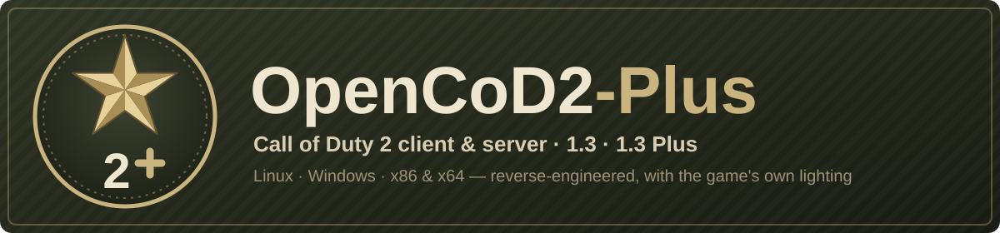
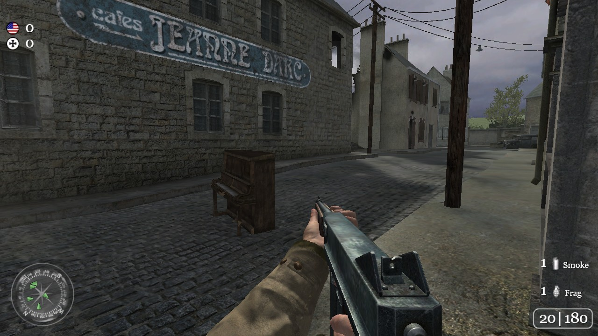
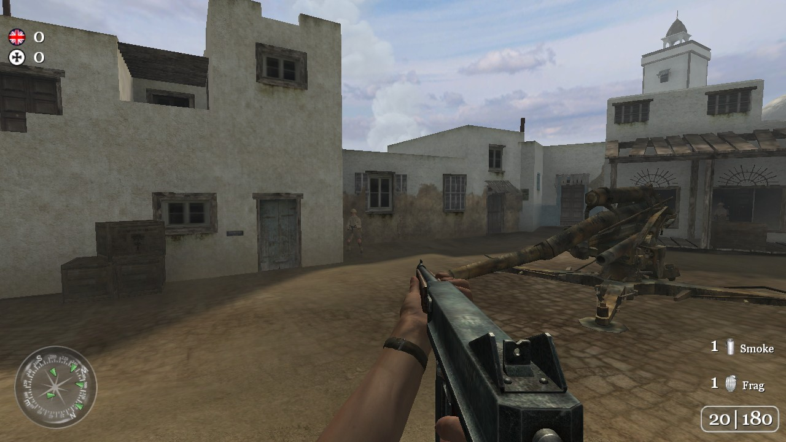
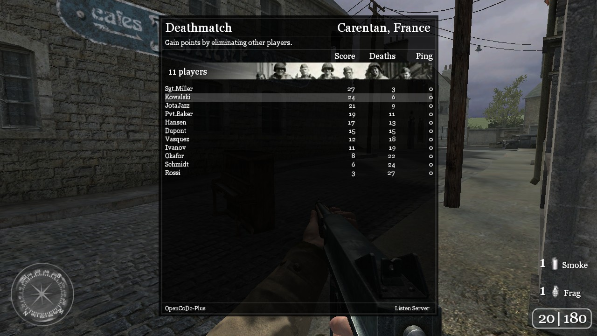

# OpenCoD2-Plus

<p align="center"></p>


[](https://github.com/opencod2/opencod2)
[](https://github.com/JotaJazz/OpenCoD2-Plus/commits/dev)

**Español** · [English](README.md) · [Português](README.pt.md) · [Français](README.fr.md) · [Deutsch](README.de.md) · [Русский](README.ru.md)

**Call of Duty 2 sigue vivo.** OpenCoD2-Plus es el motor multijugador de Call of Duty 2 reconstruido desde su código fuente: el cliente y el servidor dedicado, para Windows y Linux, hecho por gente que todavía juega y lo sigue mejorando.

Es un fork de [opencod2/opencod2](https://github.com/opencod2/opencod2), donde se hizo la ingeniería inversa del motor. Su servidor dedicado y las partidas locales del cliente corren [OpenCoD2-Plus Server](https://github.com/JotaJazz/OpenCoD2-Plus-Server), el servidor de la misma familia, y es el cliente de **CoD2 1.3 Plus**, el protocolo nuevo que habla ese servidor.

<table>
  <tr>
    <td></td>
    <td></td>
  </tr>
  <tr>
    <td colspan="2"></td>
  </tr>
</table>
<p align="center"><sub>Carentan, Toujane y una partida local con bots, dibujados por el cliente de Linux con los shaders del propio juego.</sub></p>

## Qué funciona hoy

- **Juego en línea en servidores públicos 1.3** con el cliente de Windows, con la iluminación original: Direct3D 9 y los shaders del propio juego. Los mods de un servidor se descargan por HTTP cuando los ofrece (`sv_wwwBaseURL`), también en Windows.
- **Crear una partida desde el cliente**, para que se unan tus amigos, con bots si quieres (libcod).
- **Un servidor dedicado para 1.3 y 1.0**, basado en [OpenCoD2-Plus Server](https://github.com/JotaJazz/OpenCoD2-Plus-Server) (llamado CoD2rev-Plus hasta noviembre de 2026): en Linux pasa la prueba de humo completa de OpenCoD2-Plus Server.
- **Un cliente de Linux**, y otro sobre Vulkan (DXVK) que también dibuja con los shaders del propio juego.
- **CoD2 1.3 Plus (en desarrollo):** con un servidor Plus (el `make PLUS=1` de OpenCoD2-Plus Server) el cliente habla el protocolo nuevo 1.3 Plus, con snapshots más chicos, y sus propias partidas locales también lo usan; los servidores 1.3 normales se juegan como antes.
- **Clientes de 64 bits (en desarrollo):** los clientes de Linux y Windows también se compilan para x86_64 y cargan mapas; todavía no son iguales a los de 32 bits: en Linux ya dibujan los efectos e iluminan el mundo como los de 32 bits; el de Windows ya juega en un Windows real.
- **Las mejoras de CoD2x, escritas en el motor**: `sensitivity_MG`, opciones de la brújula, `cl_maxpackets` hasta 125, `com_writeConfig`, `cl_hideServerIp`, 4096 dvars y un informe cuando el juego se congela (`com_freezeWatch`).
- **Un solo motor para todas las compilaciones:** el cliente de Windows se compila con MinGW o con el clang de Visual Studio (la ABI de MSVC), y todos los clientes y servidores corren el juego de OpenCoD2-Plus Server por el mismo puente, con la matemática de float en SSE2 como ese servidor.
- **Comprobado contra los binarios originales de 1.3**: predicción de movimiento, la mira al apuntar, efectos, sonidos, retroceso, menús y muchos arreglos ([qué cambió](docs/changes.md)).

> [!NOTE]
> **Todavía en desarrollo.** Espera errores y piezas que faltan, y por favor repórtalos en los [issues](https://github.com/JotaJazz/OpenCoD2-Plus/issues).

> [!IMPORTANT]
> **No incluye contenido del juego: pon tus propios datos.** Este repositorio es solo código fuente: no hay ejecutables, archivos, mapas, modelos, texturas, sonidos ni scripts. Para ejecutar algo tienes que poner los archivos de datos de una copia del juego **que tengas legalmente**.

## Cómo jugar

Las compilaciones listas para usar se publicarán en la página de **Releases**. Mientras tanto, compila el cliente (ver [Compilar](#compilar)) y apúntalo a tu carpeta de Call of Duty 2, la que tiene `main/`:

```bat
cod2_win32.exe +set fs_basepath "C:\path\to\CoD2" +connect IP:port
```

```sh
./cod2_linux +set fs_basepath /path/to/CoD2 +connect IP:port
```

Sin `+connect` el cliente abre el menú principal, donde también puedes crear tu propia partida. Un servidor dedicado para tu red local:

```sh
./cod2_lnxded +set fs_basepath /path/to/CoD2 +set dedicated 1 +map mp_toujane
```

## Versiones del juego

| Compilación | Juega en |
| --- | --- |
| La de CMake por defecto (1.3) | Servidores 1.3 (protocolo 118), y servidores `make PLUS=1` de OpenCoD2-Plus Server con el protocolo 1.3 Plus |
| `-DCOD2_PLUS_PROTOCOL=OFF` (1.3 normal) | Servidores 1.3; su propio servidor y sus partidas locales aceptan a cualquier jugador de 1.3, también de CoD2x, y conserva todas las demás mejoras |
| `-DCOD2_FEATURE_CFLAGS=-DCOD2_PATCH_10` (1.0) | Servidores 1.0 (protocolo 115); esta compilación está menos probada |

- **CoD2 1.3 Plus** sigue en desarrollo: snapshots más chicos camino a 40–60 Hz, y un saludo inicial que les dice a los otros clientes que actualicen. Su protocolo está en [la documentación de OpenCoD2-Plus Server](https://github.com/JotaJazz/OpenCoD2-Plus-Server/blob/dev/docs/architecture/plus-protocol.md).

## Para colaboradores

Toda ayuda cuenta: jugar y reportar errores, probar en otros sistemas, o código. El trabajo se hace en la rama `dev`, que pasa a `main` cuando sus cambios son estables. La documentación técnica, en inglés, empieza en [docs/README.md](docs/README.md); [AGENTS.md](AGENTS.md) es el punto de entrada para los agentes de programación con IA.

## Compilar

Todos los objetivos se manejan con **CMake (≥ 3.16)**, cada uno compilado fuera del código fuente en su propia carpeta.

### Linux

El motor es un binario x86 de 32 bits. En un Debian o Ubuntu de 64 bits hacen falta la arquitectura y las bibliotecas de 32 bits:

```sh
sudo dpkg --add-architecture i386 && sudo apt update
sudo apt install build-essential gcc-multilib g++-multilib cmake \
     libsdl2-dev:i386 libgl1-mesa-dev:i386 libx11-dev:i386 \
     libcurl4-openssl-dev:i386 zlib1g-dev:i386 libstdc++6:i386 \
     meson ninja-build libvulkan1:i386
```

```sh
scripts/build_linux_vk_deps.sh
cmake -S . -B build-native
cmake --build build-native -j
# -> build-native/cod2_linux    (client)
# -> build-native/cod2_lnxded   (dedicated server)
```

Las bibliotecas del cliente hacen falta para compilar los dos, pero `cod2_lnxded` se ejecuta solo con libc, libm, libz y libstdc++ de 32 bits.

`cod2_linux` dibuja con los shaders del propio juego sobre Vulkan: `scripts/build_linux_vk_deps.sh` compila DXVK native y vkd3d-shader (32 bits, de versiones fijadas), y la compilación los copia junto a él. Necesita un dispositivo Vulkan. `-DCOD2_LINUX_DXVK=OFF` lo compila en cambio sobre el dispositivo GL, sin ese script, con shaders provisionales (sin sol, cielo blanco).

### Windows (cruzado desde Linux con MinGW)

Necesita los compiladores MinGW-w64 de 32 bits (`g++-mingw-w64-i686`) y la zlib estática para MinGW (`libz-mingw-w64-dev`).

```sh
cmake -S . -B build-win32 -DCMAKE_TOOLCHAIN_FILE=cmake/toolchain-mingw32.cmake
cmake --build build-win32 -j
# -> build-win32/cod2_win32_ded.exe   (dedicated server)
```

Añade `-DCOD2_WIN32_CLIENT=ON` para el cliente, que dibuja con Direct3D 9 y los shaders del juego (`-DCOD2_WIN32_REAL_D3D9=OFF`: el dispositivo GL) (pon las bibliotecas estáticas de SDL2 en `src/win32/sdl2/lib/`; el servidor dedicado no necesita ninguna). Como el cliente de Linux, corre sus partidas locales sobre el servidor, el game y el bgame de OpenCoD2-Plus Server, y traza con su colisión. Sin Windows, `scripts/portable_wine.sh DIR` instala un Wine de 32 bits sin root (Debian o Ubuntu con i386 habilitado) y escribe `DIR/wine.sh` para correrlo; `COD2_CONSOLE_STDOUT=1` copia la consola a stdout, y `scripts/listen_test.py --host-binary cod2_win32.exe --host-wine DIR/wine.sh` hace que cree una partida a la que se une el cliente de Linux.

<details>
<summary><b>Windows (ABI de MSVC, nativo)</b></summary>

El cliente en la ABI de MSVC: clang para `i686-pc-windows-msvc`, lld-link, el runtime de MSVC y el SDK de Windows, por la misma rama de CMake que MinGW (con el puente, OpenCoD2-Plus Server y libcod). Necesita Visual Studio Build Tools 2019 o posterior con el toolset x86 y el componente "C++ Clang tools" (o cualquier clang reciente con lld-link: `-DCOD2_CLANG_DIR=<su bin>`), y el paquete de desarrollo VC de SDL (`SDL2-devel-<versión>-VC.zip`) en `third_party/SDL2-<versión>/`. Desde un símbolo del sistema "x86 Native Tools for VS":

```bat
cmake --preset msvc-client
cmake --build --preset msvc-client
:: -> build/msvc/cod2_win32.exe + third_party/SDL2-<version>/lib/x86/SDL2.dll
```

Copia `SDL2.dll` junto al ejecutable. Desde WSL, `python3 scripts/build_check.py msvc-client` lo compila en una copia del árbol en una unidad de Windows (`scripts/msvc_build.py`), y `python3 scripts/msvc_run_test.py --exe <exe>` juega una partida local con él.

</details>

<details>
<summary><b>Opciones de CMake</b></summary>

| Opción | Por defecto | Descripción |
| --- | --- | --- |
| `COD2_CXX_ALL` | `ON` | Compila el motor como C++ en Linux y MinGW. `OFF` compila C. |
| `COD2_CXX_DIRS` | `""` | Con `COD2_CXX_ALL=OFF`, los módulos o archivos de `src/` que se siguen compilando como C++. |
| `COD2_PLUS_LIBCOD` | `ON` | La libcod de OpenCoD2-Plus Server (`src/libcod`) en el servidor dedicado y en las partidas locales del cliente, con sus módulos salvo MySQL; no en el cliente de Windows de 64 bits ni en la compilación web. |
| `COD2_FEATURE_CFLAGS` | `""` | Interruptores de funciones; `-DCOD2_PATCH_10` compila la versión 1.0. |
| `COD2_PLUS_PROTOCOL` | `ON` | Las compilaciones 1.3 hablan CoD2 1.3 Plus (el `make PLUS=1` de OpenCoD2-Plus Server): sus servidores solo aceptan el cliente Plus. `OFF` compila 1.3 normal, con servidores a los que entra cualquier jugador de 1.3. |
| `COD2_WIN32_CLIENT` | `OFF` | MinGW: el cliente en vez del servidor dedicado. |
| `COD2_WIN32_REAL_D3D9` | `ON` | Cliente MinGW: Direct3D 9 real y los shaders del juego (d3dx9 del sistema); `OFF` mantiene el dispositivo GL. |
| `COD2_MSVC_ABI` | `OFF` | Lo fija `cmake/toolchain-msvc-clang.cmake`: la rama de Windows en la ABI de MSVC. |
| `COD2_DEBUG` | `OFF` | `-O0` y sin endurecimiento, para depurar. |
| `COD2_X64` | `OFF` | Objetivo x86_64: el cliente Linux (antes `scripts/linux_x64_deps.sh`) y el de Windows (`scripts/mingw64_deps.sh`, `cmake/toolchain-mingw64.cmake`) cargan mapas; todavía no son iguales a los de 32 bits. |

También hay una compilación WebAssembly (`emcmake cmake -S . -B build/web`, con el SDK de Emscripten), descrita al principio de `CMakeLists.txt`.

</details>

## Pruebas

<details>
<summary><b>Los scripts de prueba</b></summary>

Las comprobaciones necesitan la compilación y, las que arrancan el servidor, una carpeta del juego con las `.iwd` originales. Arrancan el servidor en modo LAN con una carpeta de usuario temporal, así que la carpeta del juego solo se lee.

```bash
python3 scripts/build_check.py all                      # every variant (linux, linux-10, mingw, mingw-client...) into build/check-*/
python3 scripts/check_c_linkage.py build/check-linux    # no unexpected C++ names in the engine
python3 scripts/layout_parity.py                        # types shared with OpenCoD2-Plus Server's VM lay out alike
python3 scripts/check_c_decls.py build/check-linux     # cada llamada del motor coincide con los tipos de su definición
python3 scripts/check_var_sizes.py build/check-linux    # ninguna global se usa más grande de lo que se define
python3 scripts/opencod2_smoke.py /path/to/CoD2 --protocol 118
python3 scripts/two_players_test.py /path/to/CoD2 --protocol 118
python3 scripts/listen_test.py /path/to/CoD2 --protocol 118
python3 scripts/map_reload_test.py /path/to/CoD2 --protocol 118
python3 scripts/rcon_drop_test.py /path/to/CoD2 --protocol 118
python3 scripts/anim_builtins_test.py /path/to/CoD2 --protocol 118
python3 scripts/prediction_test.py /path/to/CoD2 --protocol 118
python3 scripts/fx_test.py /path/to/CoD2 --protocol 118
python3 scripts/hud_align_test.py /path/to/CoD2 --protocol 118
python3 scripts/www_download_test.py /path/to/CoD2
python3 scripts/bots_test.py /path/to/CoD2 --binary build/check-linux/cod2_lnxded
python3 scripts/http_test.py /path/to/CoD2 --binary build/check-linux/cod2_lnxded
python3 scripts/vendor_check.py /path/to/OpenCoD2-Plus-Server   # files copied from OpenCoD2-Plus Server are unchanged
python3 -m unittest discover -s test
```

- `opencod2_smoke.py` ejecuta el `scripts/smoke_test.py` de OpenCoD2-Plus Server, sin cambios, y compara sus fallos con `test/smoke_expected_failures_<protocolo>.txt`: las comprobaciones que este servidor todavía no pasa. Falla ante un fallo nuevo y ante uno de la lista que ahora pasa, así que las listas solo se achican. `--protocol 115` prueba la compilación 1.0. `--protocol 118 --binary build/check-mingw/cod2_win32_ded.exe --wine DIR/wine.sh` lo ejecuta contra el servidor dedicado de Windows bajo Wine (`scripts/portable_wine.sh`), con su propia lista, `test/smoke_expected_failures_wine.txt`: bajo Wine el servidor imprime solo en su ventana y una señal no le llega como tal (un SIGSEGV enviado con `kill` se ignora, SIGTERM lo termina de inmediato), así que ahí no se comprueban el informe de crash, las comprobaciones de SIGTERM ni las que leen su salida (el envoltorio comprueba `net_strictPort` en su log de consola). Las listas de Linux están vacías: el servidor dedicado pasa la prueba de humo completa.
- `two_players_test.py` conecta dos clientes en tdm, les hace enviar comandos, desconecta a uno y lo vuelve a conectar, y expulsa al otro; el servidor, con `developer 1` para que un error de script detenga el mapa, tiene que responder después de cada paso.
- `listen_test.py` arranca un cliente que crea una partida y otro que se conecta, y los comprueba después de un `map_restart` y de un cambio de mapa; necesita una CD key en `~/.cod2/preferences`.
- `map_reload_test.py` carga mapas por rcon, alternando `map_restart` y `map` entre dos mapas, y comprueba cada carga; `rcon_drop_test.py` lanza un error de drop desde rcon (`error drop`) y comprueba que el servidor siga en pie.
- `anim_builtins_test.py` ejecuta `getAnimLength`, `animHasNotetrack`, `getMoveDelta` y `getAngleDelta` desde el script de mapa de un mod de prueba.
- `prediction_test.py` cuenta los errores de predicción de un cliente real (con clave de CD) que camina, se agacha, se tira al suelo, salta y dispara; `--max-misses` fija cuántos admite.
- `fx_test.py` hace que un cliente real (con clave de CD) reproduzca un sprite, un impacto de bala y dos explosiones delante de él, y comprueba que cada uno cambie la captura.
- `hud_align_test.py` da a un cliente real (con clave de CD) tres cuadros de colores con distintos pares `horzAlign`/`vertAlign`, como el título de una killcam, y comprueba en una captura que cada uno quede donde lo pone la 1.3.
- `www_download_test.py` hace que un cliente entre a un servidor cuyo mod no tiene y lo baje de un servidor HTTP local; `--wine DIR/wine.sh --binary build/check-mingw-client/cod2_win32.exe` usa el cliente de Windows, `--disconnect` deja que el servidor le pida salir, descargar y volver.
- `bots_test.py` y `http_test.py` son los de OpenCoD2-Plus Server, sin cambios, para libcod: los bots de `mods/bots` deben encontrar sus rutas, guardar y releer su grafo y pelear en un mapa real; `httpFetch` y `webSocket*` deben funcionar contra servidores locales HTTP, HTTPS, WS y WSS (necesitan `openssl`). Pásales `--binary build/check-linux/cod2_lnxded`.
- `scripts/cxx_errors.py` cuenta los errores de C++ de un módulo (`--return-type` encuentra funciones no `void` que pueden terminar sin `return`, algo indefinido en C++); `scripts/gen_script_bridge.py --module script|server|client_server` regenera el puente con la máquina virtual de scripts o con el servidor, y `scripts/engine_abi.py --module server` registra, con gdb, la ABI del motor contra la que se comprueba el puente (`test/server_abi.txt`).

</details>

## Estructura del repositorio

<details>
<summary><b>Qué hay dónde</b></summary>

| Ruta | Contenido |
| --- | --- |
| `src/PC` | El motor reconstruido: cliente (`client_mp`, `cgame_mp`, `ui_mp`), el bgame de cgame (`bgame`), render (`gfx_d3d`), código compartido (`qcommon`, `universal`) y animaciones (`xanim`). El servidor, el juego, la máquina virtual de scripts y la colisión son los de OpenCoD2-Plus Server en todas las compilaciones; los servidores dedicados dejan afuera además el núcleo que reemplaza (`test/plus_replaces.txt`). |
| `src/Mac` | La capa de plataforma del port de Mac del que sale la reconstrucción: OpenGL detrás de una interfaz de Direct3D, y entrada. |
| `src/snd_sdl` | Nuestro motor de sonido sobre SDL2, detrás de las llamadas `AIL_*` de Miles: el sonido de ambos clientes, sin `mss32.dll`. |
| `src/script` | La máquina virtual de scripts de OpenCoD2-Plus Server, copiada sin cambios, con los headers que necesita en `src/qcommon`, `src/universal`, `src/game`, `src/bgame`, `src/server`, `src/xanim`, `src/zlib`, `src/misc` y `src/libcod`. |
| `src/server` | El servidor de OpenCoD2-Plus Server, copiado sin cambios; lo usa el servidor dedicado. |
| `src/game`, `src/bgame` | El game y el bgame de OpenCoD2-Plus Server, copiados sin cambios; los usa el servidor dedicado. |
| `src/universal`, `src/qcommon`, `src/xanim`, `src/unix`, `src/win32` | El núcleo y el código de plataforma de OpenCoD2-Plus Server, copiados sin cambios; sobre ellos corre el servidor dedicado. `test/plus_replaces.txt` lista las fuentes del motor que reemplazan ahí. |
| `src/libcod`, `mods/bots` | La libcod de OpenCoD2-Plus Server y sus bibliotecas (yyjson, SQLite, Mbed TLS; su Speex no se compila, se usa el del motor), y su mod de bots, copiados sin cambios; los usan el servidor dedicado y las partidas locales del cliente. |
| `src/compat` | Los puentes entre los nombres de C del motor y la máquina virtual, el servidor y el núcleo C++ de OpenCoD2-Plus Server; casi todo generado. |
| `src/headers`, `src/imports` | Tipos compartidos, desplazamientos comprobados contra el binario original y declaraciones de las funciones importadas. |
| `src/blobs`, `build/native_gen`, `build/win_gen` | Datos sacados del binario original, que el motor todavía usa. |
| `src/unix`, `src/win32`, `src/stubs`, `src/web` | Código de cada plataforma y stubs. |
| `scripts` | Scripts de compilación y de prueba, y el cliente de prueba de OpenCoD2-Plus Server. |
| `test` | Pruebas unitarias y las listas que leen las comprobaciones. |
| `docs` | La [documentación](docs/README.md) y el banner. |

</details>

## Transparencia

- **Quién mantiene esto:** soy JotaJazz. Me gustan los juegos antiguos y este fork existe por eso: quiero seguir jugando CoD2 con mis amigos y mantener vivo el juego para la comunidad que todavía lo juega, con un proyecto abierto.
- **Cómo se trabaja aquí:** trabajo con [Claude Code](https://claude.com/claude-code), el asistente de programación de Anthropic. Los cambios de este fork, incluidos este README y sus traducciones, están escritos con su ayuda. Los commits hechos así llevan la línea `Co-Authored-By: Claude` en el mensaje, de modo que se pueden identificar en el historial con `git log`.
- **Relación con el original:** la reconstrucción es obra de los autores de opencod2 (riicchhaarrd) y de Sipex. Este fork ya no trae cambios de ellos; en su lugar trae código de OpenCoD2-Plus Server, copiado sin cambios para que sus commits también se apliquen aquí.
- **Qué no es:** no es un proyecto oficial ni está afiliado a Activision, Infinity Ward ni a los autores del repositorio original. No incluye ningún archivo del juego.

## Aviso

Esta es una reconstrucción independiente, a nivel de código fuente, del motor de Call of Duty 2. No está afiliada a Activision Publishing, Inc., Infinity Ward ni a ninguna de sus filiales, ni autorizada, patrocinada o respaldada por ellas.

"Call of Duty" y "Call of Duty 2" son marcas registradas de Activision Publishing, Inc. Se usan en este repositorio solo para identificar y para la interoperabilidad, para describir lo que el código reconstruye. No se reivindica ningún derecho sobre esas marcas.

Este proyecto no proporciona datos del juego protegidos por derechos de autor ni ayuda a obtenerlos. Para usarlo con contenido real del juego, tienes que poner los archivos de datos de una copia de Call of Duty 2 que tengas legalmente.

El código fuente reconstruido del motor es una obra derivada creada con fines de preservación, interoperabilidad, investigación y educación. Se proporciona tal cual, sin garantía de ningún tipo, expresa ni implícita.

Si eres titular de derechos y crees que algo de aquí no debería distribuirse, abre un issue o contacta con el mantenedor y se atenderá cuanto antes.

Las capturas muestran contenido de Call of Duty 2, propiedad de Activision Publishing, Inc., solo con fines de identificación.

## Licencia

Todavía ninguna, como en el original. El código de OpenCoD2-Plus Server que hay aquí (máquina virtual de scripts, servidor, game, núcleo, libcod y su mod de bots) es AGPL-3.0, y la licencia del conjunto se está resolviendo con los autores originales. Las bibliotecas de terceros mantienen las suyas: SQLite (dominio público), Mbed TLS (Apache-2.0, `src/libcod/mbedtls/LICENSE`), yyjson (MIT) y Speex (BSD, no se compila).

## Créditos

- [opencod2](https://github.com/opencod2/opencod2) (riicchhaarrd), la reconstrucción del motor
- [Sipex18/opencod2-web](https://github.com/Sipex18/opencod2-web) (Sipex), endurecimiento del código y arreglos de red
- [OpenCoD2-Plus Server](https://github.com/JotaJazz/OpenCoD2-Plus-Server) y [voron00/CoD2rev_Server](https://github.com/voron00/CoD2rev_Server), el servidor dedicado y la máquina virtual de scripts
- id Software
- Activision / Infinity Ward
