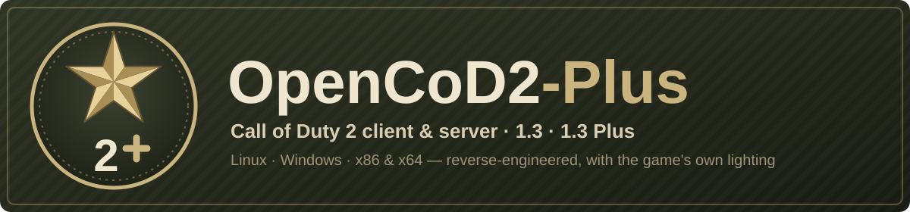
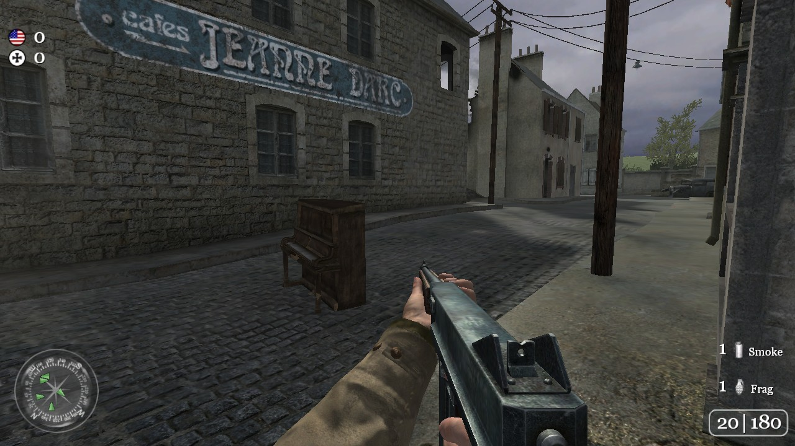
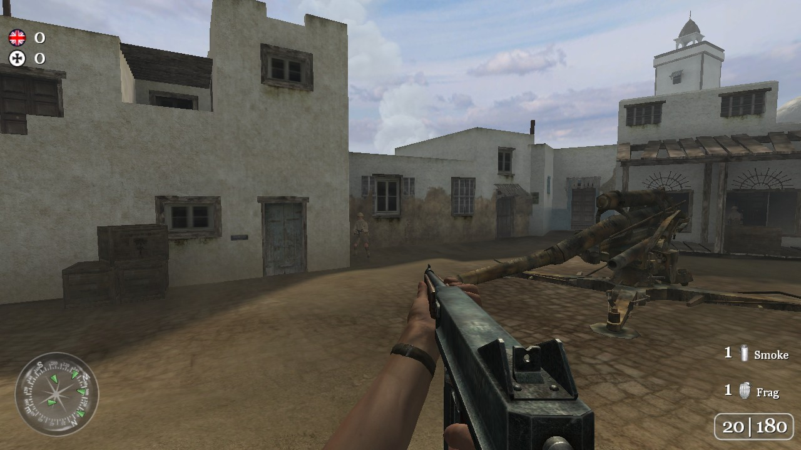
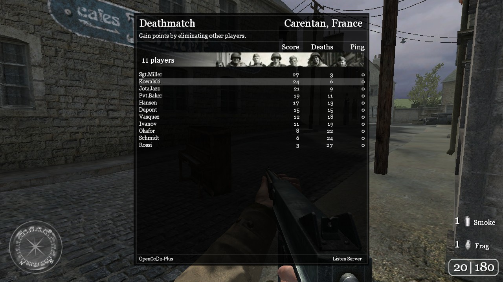

# OpenCoD2-Plus

<p align="center"></p>


[](https://github.com/opencod2/opencod2)
[](https://github.com/JotaJazz/OpenCoD2-Plus/commits/dev)

[Español](README.es.md) · [English](README.md) · **Português** · [Français](README.fr.md) · [Deutsch](README.de.md) · [Русский](README.ru.md)

**O Call of Duty 2 continua vivo.** O OpenCoD2-Plus é o motor multijogador de Call of Duty 2 reconstruído a partir do seu código-fonte: o cliente e o servidor dedicado, para Windows e Linux, feito por pessoas que ainda jogam o jogo e o continuam a melhorar.

É um fork de [opencod2/opencod2](https://github.com/opencod2/opencod2), onde foi feita a engenharia reversa do motor. O seu servidor dedicado e as partidas locais do cliente correm o [OpenCoD2-Plus Server](https://github.com/JotaJazz/OpenCoD2-Plus-Server), o servidor da mesma família, e é o cliente do **CoD2 1.3 Plus**, o protocolo novo que esse servidor fala.

<table>
  <tr>
    <td></td>
    <td></td>
  </tr>
  <tr>
    <td colspan="2"></td>
  </tr>
</table>
<p align="center"><sub>Carentan, Toujane e um jogo local com bots, desenhados pelo cliente Linux com os shaders do próprio jogo.</sub></p>

## O que já funciona

- **Jogar online em servidores públicos 1.3** com o cliente Windows, com a iluminação original: Direct3D 9 e os shaders do próprio jogo. Os mods de um servidor descarregam-se por HTTP quando ele os oferece (`sv_wwwBaseURL`), também no Windows.
- **Criar um jogo a partir do cliente**, para os amigos entrarem, com bots se quiser (libcod).
- **Um servidor dedicado para 1.3 e 1.0**, assente no [OpenCoD2-Plus Server](https://github.com/JotaJazz/OpenCoD2-Plus-Server) (chamado CoD2rev-Plus até novembro de 2026): no Linux passa todo o teste de fumo do OpenCoD2-Plus Server.
- **Um cliente Linux**, e outro sobre Vulkan (DXVK) que também desenha com os shaders do próprio jogo.
- **CoD2 1.3 Plus (em desenvolvimento):** com um servidor Plus (o `make PLUS=1` do OpenCoD2-Plus Server) o cliente fala o novo protocolo 1.3 Plus, com snapshots menores, e as suas próprias partidas locais também o usam; os servidores 1.3 normais jogam-se como antes.
- **Clientes de 64 bits (em desenvolvimento):** os clientes de Linux e Windows também compilam para x86_64 e carregam mapas; ainda não são iguais aos de 32 bits: no Linux já desenham os efeitos e iluminam o mundo como os de 32 bits; o de Windows já joga num Windows real.
- **As melhorias do CoD2x, escritas no motor**: `sensitivity_MG`, opções da bússola, `cl_maxpackets` até 125, `com_writeConfig`, `cl_hideServerIp`, 4096 dvars e um relatório quando o jogo congela (`com_freezeWatch`).
- **Um só motor para todas as compilações:** o cliente de Windows compila com o MinGW ou com o clang do Visual Studio (a ABI do MSVC), e todos os clientes e servidores correm o jogo do OpenCoD2-Plus Server pela mesma ponte, com a matemática de float em SSE2 como esse servidor.
- **Verificado contra os binários originais da 1.3**: previsão de movimento, a mira ao apontar, efeitos, sons, recuo, menus e muitas correções ([o que mudou](docs/changes.md)).

> [!NOTE]
> **Ainda em desenvolvimento.** Espere falhas e partes em falta, e por favor reporte-as nas [issues](https://github.com/JotaJazz/OpenCoD2-Plus/issues).

> [!IMPORTANT]
> **Nenhum conteúdo do jogo está incluído — traga os seus próprios dados.** Este repositório contém apenas código-fonte: nenhum executável, arquivo, mapa, modelo, textura, som ou script. Para executar qualquer coisa, é preciso fornecer ficheiros de dados de uma cópia do jogo que **possua legalmente**.

## Como jogar

As compilações prontas a usar serão publicadas na página de **Releases**. Até lá, compile o cliente (ver [Compilar](#compilar)) e aponte-o para a sua pasta do Call of Duty 2, a que tem `main/`:

```bat
cod2_win32.exe +set fs_basepath "C:\path\to\CoD2" +connect IP:port
```

```sh
./cod2_linux +set fs_basepath /path/to/CoD2 +connect IP:port
```

Sem `+connect` o cliente abre o menu principal, onde também pode iniciar o seu próprio jogo. Um servidor dedicado para a sua rede local:

```sh
./cod2_lnxded +set fs_basepath /path/to/CoD2 +set dedicated 1 +map mp_toujane
```

## Versões do jogo

| Compilação | Joga em |
| --- | --- |
| A predefinida do CMake (1.3) | Servidores 1.3 (protocolo 118), e servidores `make PLUS=1` do OpenCoD2-Plus Server com o protocolo 1.3 Plus |
| `-DCOD2_PLUS_PROTOCOL=OFF` (1.3 normal) | Servidores 1.3; o seu próprio servidor e as partidas locais aceitam qualquer jogador de 1.3, também de CoD2x, e mantém todas as outras melhorias |
| `-DCOD2_FEATURE_CFLAGS=-DCOD2_PATCH_10` (1.0) | Servidores 1.0 (protocolo 115); esta compilação está menos testada |

- O **CoD2 1.3 Plus** ainda está em desenvolvimento: snapshots menores a caminho dos 40–60 Hz, e uma saudação inicial que diz aos outros clientes para atualizarem. O seu protocolo está na [documentação do OpenCoD2-Plus Server](https://github.com/JotaJazz/OpenCoD2-Plus-Server/blob/dev/docs/architecture/plus-protocol.md).

## Para colaboradores

Toda a ajuda conta: jogar e reportar falhas, testar noutros sistemas, ou código. O trabalho faz-se no ramo `dev`, que passa para `main` quando as suas alterações estão estáveis. A documentação técnica, em inglês, começa em [docs/README.md](docs/README.md); o [AGENTS.md](AGENTS.md) é o ponto de entrada para agentes de programação com IA.

## Compilar

Todos os alvos são geridos pelo **CMake (≥ 3.16)**, cada um numa compilação fora da árvore de código, na sua própria pasta.

### Linux

O motor é um binário x86 de 32 bits. Num sistema Debian ou Ubuntu de 64 bits são necessárias a arquitetura e as bibliotecas de 32 bits:

```sh
sudo dpkg --add-architecture i386 && sudo apt update
sudo apt install build-essential gcc-multilib g++-multilib cmake \
     libsdl2-dev:i386 libgl1-mesa-dev:i386 libx11-dev:i386 \
     libcurl4-openssl-dev:i386 zlib1g-dev:i386 libstdc++6:i386 \
     meson ninja-build libvulkan1:i386
```

```sh
scripts/build_linux_vk_deps.sh
cmake -S . -B build-native
cmake --build build-native -j
# -> build-native/cod2_linux    (client)
# -> build-native/cod2_lnxded   (dedicated server)
```

As bibliotecas do cliente são precisas para compilar os dois, mas o `cod2_lnxded` executa apenas com a libc, a libm, a libz e a libstdc++ de 32 bits.

O `cod2_linux` desenha com os shaders do próprio jogo sobre Vulkan: `scripts/build_linux_vk_deps.sh` compila o DXVK native e o vkd3d-shader (32 bits, de versões fixadas), e a compilação os copia ao lado dele. Precisa de um dispositivo Vulkan. `-DCOD2_LINUX_DXVK=OFF` o compila no dispositivo GL, sem esse script, com shaders provisórios (sem sol, céu branco).

### Windows (cruzado a partir do Linux com MinGW)

Precisa dos compiladores MinGW-w64 de 32 bits (`g++-mingw-w64-i686`) e da zlib estática para MinGW (`libz-mingw-w64-dev`).

```sh
cmake -S . -B build-win32 -DCMAKE_TOOLCHAIN_FILE=cmake/toolchain-mingw32.cmake
cmake --build build-win32 -j
# -> build-win32/cod2_win32_ded.exe   (dedicated server)
```

Acrescente `-DCOD2_WIN32_CLIENT=ON` para o cliente, que desenha com Direct3D 9 e os shaders do jogo (`-DCOD2_WIN32_REAL_D3D9=OFF`: o dispositivo GL) (forneça as bibliotecas estáticas do SDL2 em `src/win32/sdl2/lib/`; o servidor dedicado não precisa de nenhuma). Como o cliente Linux, corre os seus jogos locais sobre o servidor, o game e o bgame do OpenCoD2-Plus Server, e traça com a sua colisão. Sem Windows, `scripts/portable_wine.sh DIR` instala um Wine de 32 bits sem root (Debian ou Ubuntu com i386 ativado) e escreve `DIR/wine.sh` para o executar; `COD2_CONSOLE_STDOUT=1` copia a consola para stdout, e `scripts/listen_test.py --host-binary cod2_win32.exe --host-wine DIR/wine.sh` faz com que crie um jogo onde entra o cliente Linux.

<details>
<summary><b>Windows (ABI do MSVC, nativo)</b></summary>

O cliente na ABI do MSVC: clang para `i686-pc-windows-msvc`, lld-link, o runtime do MSVC e o SDK do Windows, pelo mesmo ramo de CMake que o MinGW (com a ponte, o OpenCoD2-Plus Server e a libcod). Precisa do Visual Studio Build Tools 2019 ou mais recente com o toolset x86 e o componente "C++ Clang tools" (ou qualquer clang recente com lld-link: `-DCOD2_CLANG_DIR=<o seu bin>`), e do pacote de desenvolvimento VC do SDL (`SDL2-devel-<versão>-VC.zip`) em `third_party/SDL2-<versão>/`. A partir de uma linha de comandos "x86 Native Tools for VS":

```bat
cmake --preset msvc-client
cmake --build --preset msvc-client
:: -> build/msvc/cod2_win32.exe + third_party/SDL2-<version>/lib/x86/SDL2.dll
```

Copia `SDL2.dll` para junto do executável. No WSL, `python3 scripts/build_check.py msvc-client` compila-o numa cópia da árvore numa unidade do Windows (`scripts/msvc_build.py`), e `python3 scripts/msvc_run_test.py --exe <exe>` joga com ele um jogo local.

</details>

<details>
<summary><b>Opções do CMake</b></summary>

| Opção | Predefinição | Descrição |
| --- | --- | --- |
| `COD2_CXX_ALL` | `ON` | Compila o motor como C++ no Linux e no MinGW. `OFF` compila C. |
| `COD2_CXX_DIRS` | `""` | Com `COD2_CXX_ALL=OFF`, os módulos ou ficheiros de `src/` que continuam a ser compilados como C++. |
| `COD2_PLUS_LIBCOD` | `ON` | A libcod do OpenCoD2-Plus Server (`src/libcod`) no servidor dedicado e nos jogos locais do cliente, com os seus módulos exceto o MySQL; não no cliente de Windows de 64 bits nem na compilação web. |
| `COD2_FEATURE_CFLAGS` | `""` | Opções de funcionalidades; `-DCOD2_PATCH_10` compila a versão 1.0. |
| `COD2_PLUS_PROTOCOL` | `ON` | As compilações 1.3 falam CoD2 1.3 Plus (o `make PLUS=1` do OpenCoD2-Plus Server): os seus servidores só aceitam o cliente Plus. `OFF` compila 1.3 normal, com servidores onde entra qualquer jogador de 1.3. |
| `COD2_WIN32_CLIENT` | `OFF` | MinGW: o cliente em vez do servidor dedicado. |
| `COD2_WIN32_REAL_D3D9` | `ON` | Cliente MinGW: Direct3D 9 real e os shaders do jogo (d3dx9 do sistema); `OFF` mantém o dispositivo GL. |
| `COD2_MSVC_ABI` | `OFF` | Definida por `cmake/toolchain-msvc-clang.cmake`: o ramo do Windows na ABI do MSVC. |
| `COD2_DEBUG` | `OFF` | `-O0` e sem hardening, para depuração. |
| `COD2_X64` | `OFF` | Alvo x86_64: o cliente Linux (antes `scripts/linux_x64_deps.sh`) e o de Windows (`scripts/mingw64_deps.sh`, `cmake/toolchain-mingw64.cmake`) carregam mapas; ainda não são iguais aos de 32 bits. |

Existe também uma compilação WebAssembly (`emcmake cmake -S . -B build/web`, com o Emscripten SDK), descrita no início de `CMakeLists.txt`.

</details>

## Testes

<details>
<summary><b>Os scripts de testes</b></summary>

As verificações precisam da compilação e, as que iniciam o servidor, de uma pasta do jogo com os `.iwd` originais. Iniciam o servidor em modo LAN com uma pasta de utilizador temporária, pelo que a pasta do jogo só é lida.

```bash
python3 scripts/build_check.py all                      # every variant (linux, linux-10, mingw, mingw-client...) into build/check-*/
python3 scripts/check_c_linkage.py build/check-linux    # no unexpected C++ names in the engine
python3 scripts/layout_parity.py                        # types shared with OpenCoD2-Plus Server's VM lay out alike
python3 scripts/check_c_decls.py build/check-linux     # cada chamada do motor corresponde aos tipos da sua definição
python3 scripts/check_var_sizes.py build/check-linux    # nenhuma global é usada maior do que é definida
python3 scripts/opencod2_smoke.py /path/to/CoD2 --protocol 118
python3 scripts/two_players_test.py /path/to/CoD2 --protocol 118
python3 scripts/listen_test.py /path/to/CoD2 --protocol 118
python3 scripts/map_reload_test.py /path/to/CoD2 --protocol 118
python3 scripts/rcon_drop_test.py /path/to/CoD2 --protocol 118
python3 scripts/anim_builtins_test.py /path/to/CoD2 --protocol 118
python3 scripts/prediction_test.py /path/to/CoD2 --protocol 118
python3 scripts/fx_test.py /path/to/CoD2 --protocol 118
python3 scripts/hud_align_test.py /path/to/CoD2 --protocol 118
python3 scripts/www_download_test.py /path/to/CoD2
python3 scripts/bots_test.py /path/to/CoD2 --binary build/check-linux/cod2_lnxded
python3 scripts/http_test.py /path/to/CoD2 --binary build/check-linux/cod2_lnxded
python3 scripts/vendor_check.py /path/to/OpenCoD2-Plus-Server   # files copied from OpenCoD2-Plus Server are unchanged
python3 -m unittest discover -s test
```

- `opencod2_smoke.py` executa o `scripts/smoke_test.py` do OpenCoD2-Plus Server, sem alterações, e compara as suas falhas com `test/smoke_expected_failures_<protocol>.txt`: as verificações que este servidor ainda não passa. Falha perante uma falha nova e perante uma da lista que agora passa, pelo que as listas só diminuem. `--protocol 115` testa a compilação 1.0. `--protocol 118 --binary build/check-mingw/cod2_win32_ded.exe --wine DIR/wine.sh` executa-o contra o servidor dedicado de Windows sob Wine (`scripts/portable_wine.sh`), com a sua própria lista, `test/smoke_expected_failures_wine.txt`: sob Wine o servidor escreve só na sua janela e um sinal não lhe chega como tal (um SIGSEGV enviado com `kill` é ignorado, o SIGTERM termina-o de imediato), por isso aí não se fazem o relatório de crash, as verificações de SIGTERM nem as que leem a sua saída (o script verifica `net_strictPort` no seu log de consola). As listas de Linux estão vazias: o servidor dedicado passa todo o teste de fumo.
- `two_players_test.py` liga dois clientes em tdm, faz com que enviem comandos, desliga um e volta a ligá-lo, e expulsa o outro; o servidor, com `developer 1` para que um erro de script pare o mapa, deve responder após cada passo.
- `listen_test.py` arranca um cliente que cria um jogo e um segundo que entra nele, e verifica-os depois de um `map_restart` e de uma mudança de mapa; precisa de uma CD key em `~/.cod2/preferences`.
- `map_reload_test.py` carrega mapas por rcon, alternando `map_restart` e `map` entre dois mapas, e verifica cada carregamento; `rcon_drop_test.py` lança um erro drop a partir do rcon (`error drop`) e verifica que o servidor continua de pé.
- `anim_builtins_test.py` executa `getAnimLength`, `animHasNotetrack`, `getMoveDelta` e `getAngleDelta` a partir do script de nível de um mod de teste.
- `prediction_test.py` conta os erros de previsão de um cliente real (com chave de CD) que anda, se agacha, se deita, salta e dispara; `--max-misses` define quantos admite.
- `fx_test.py` faz um cliente real (com chave de CD) reproduzir um sprite, um impacto de bala e duas explosões à sua frente, e verifica que cada um muda a captura.
- `hud_align_test.py` dá a um cliente real (com chave de CD) três caixas coloridas com pares `horzAlign`/`vertAlign` diferentes, como o título de uma killcam, e verifica numa captura que cada uma fica onde a 1.3 a põe.
- `www_download_test.py` faz um cliente entrar num servidor cujo mod não tem e descarregá-lo de um servidor HTTP local; `--wine DIR/wine.sh --binary build/check-mingw-client/cod2_win32.exe` usa o cliente Windows, `--disconnect` deixa o servidor pedir-lhe que saia, descarregue e volte.
- `bots_test.py` e `http_test.py` são os do OpenCoD2-Plus Server, sem alterações, para a libcod: os bots de `mods/bots` têm de encontrar os seus caminhos, guardar e reler o seu grafo e lutar num mapa real; `httpFetch` e `webSocket*` têm de funcionar contra servidores locais HTTP, HTTPS, WS e WSS (precisam de `openssl`). Passe-lhes `--binary build/check-linux/cod2_lnxded`.
- `scripts/cxx_errors.py` conta os erros de C++ de um módulo (`--return-type` encontra funções não void que podem terminar sem return, o que é indefinido em C++); `scripts/gen_script_bridge.py --module script|server|client_server` regenera a ponte para a VM de scripts ou para o servidor, e `scripts/engine_abi.py --module server` regista, com o gdb, a ABI do motor contra a qual a ponte verifica (`test/server_abi.txt`).

</details>

## Estrutura do repositório

<details>
<summary><b>O que está onde</b></summary>

| Caminho | Conteúdo |
| --- | --- |
| `src/PC` | O motor reconstruído: cliente (`client_mp`, `cgame_mp`, `ui_mp`), o bgame do cgame (`bgame`), renderizador (`gfx_d3d`), código comum (`qcommon`, `universal`) e animações (`xanim`). O servidor, o jogo, a VM de scripts e a colisão são os do OpenCoD2-Plus Server em todas as compilações; os servidores dedicados deixam de fora também o núcleo que ele substitui (`test/plus_replaces.txt`). |
| `src/Mac` | A camada de plataforma do port para Mac de onde veio a reconstrução: OpenGL por trás de uma interface Direct3D, e entrada. |
| `src/snd_sdl` | O nosso motor de som sobre SDL2, por trás das chamadas `AIL_*` do Miles: o som dos dois clientes, sem `mss32.dll`. |
| `src/script` | A VM de scripts do OpenCoD2-Plus Server, copiada sem alterações, com os cabeçalhos de que precisa em `src/qcommon`, `src/universal`, `src/game`, `src/bgame`, `src/server`, `src/xanim`, `src/zlib`, `src/misc` e `src/libcod`. |
| `src/server` | O servidor do OpenCoD2-Plus Server, copiado sem alterações; é usado pelo servidor dedicado. |
| `src/game`, `src/bgame` | O game e o bgame do OpenCoD2-Plus Server, copiados sem alterações; são usados pelo servidor dedicado. |
| `src/universal`, `src/qcommon`, `src/xanim`, `src/unix`, `src/win32` | O núcleo e o código de plataforma do OpenCoD2-Plus Server, copiados sem alterações; o servidor dedicado corre sobre eles. `test/plus_replaces.txt` lista as fontes do motor que eles substituem lá. |
| `src/libcod`, `mods/bots` | A libcod do OpenCoD2-Plus Server e as suas bibliotecas (yyjson, SQLite, Mbed TLS; o seu Speex não é compilado, usa-se o do motor), e o seu mod de bots, copiados sem alterações; o servidor dedicado e os jogos locais do cliente usam-nos. |
| `src/compat` | As pontes entre os nomes C do motor e a VM C++, o servidor e o núcleo do OpenCoD2-Plus Server; na maior parte geradas. |
| `src/headers`, `src/imports` | Tipos partilhados, offsets verificados contra o binário original e declarações de funções importadas. |
| `src/blobs`, `build/native_gen`, `build/win_gen` | Dados tirados do binário original, ainda usados pelo motor. |
| `src/unix`, `src/win32`, `src/stubs`, `src/web` | Código de plataforma e stubs. |
| `scripts` | Scripts de compilação e de testes, e o cliente de testes do OpenCoD2-Plus Server. |
| `test` | Testes unitários e as listas que as verificações leem. |
| `docs` | A [documentação](docs/README.md) e o banner. |

</details>

## Transparência

- **Quem mantém isto:** sou o JotaJazz. Gosto de jogos antigos e este fork existe por isso: quero continuar a jogar CoD2 com os meus amigos e manter o jogo vivo para a comunidade que ainda o joga, com um projeto aberto.
- **Como se trabalha aqui:** trabalho com o [Claude Code](https://claude.com/claude-code), o assistente de programação da Anthropic. As alterações deste fork, incluindo este README e as suas traduções, são escritas com a sua ajuda. Os commits feitos assim têm a linha `Co-Authored-By: Claude` na mensagem, pelo que podem ser identificados no histórico com `git log`.
- **Relação com o original:** a reconstrução é obra dos autores do opencod2 (riicchhaarrd) e do Sipex. Este fork já não traz alterações deles; em vez disso, traz código do OpenCoD2-Plus Server, copiado sem alterações para que os seus commits também se apliquem aqui.
- **O que não é:** não é um projeto oficial nem está associado à Activision, à Infinity Ward ou aos autores do repositório original. Não inclui nenhum ficheiro do jogo.

## Aviso

Esta é uma reconstrução independente, ao nível do código-fonte, do motor de Call of Duty 2. Não está associada, autorizada, patrocinada nem endossada pela Activision Publishing, Inc., pela Infinity Ward ou por qualquer uma das suas afiliadas.

"Call of Duty" e "Call of Duty 2" são marcas registadas da Activision Publishing, Inc. São usadas neste repositório apenas para identificação e interoperabilidade, para descrever o que o código reconstrói. Não é reivindicado nenhum direito sobre essas marcas.

Este projeto não fornece dados de jogo protegidos por direitos de autor nem ajuda a obtê-los. Para usá-lo com conteúdo real do jogo, é preciso fornecer ficheiros de dados de uma cópia de Call of Duty 2 que possua legalmente.

O código-fonte do motor reconstruído é uma obra derivada criada para fins de preservação, interoperabilidade, investigação e educação. É fornecido no estado em que se encontra, sem garantia de qualquer tipo, expressa ou implícita.

Se é titular de direitos e acredita que algo aqui não deveria ser distribuído, abra uma issue ou contacte o responsável pela manutenção, e o assunto será tratado prontamente.

As capturas de ecrã mostram conteúdo de Call of Duty 2, propriedade da Activision Publishing, Inc., apenas para identificação.

## Licença

Ainda nenhuma, como no original. O código do OpenCoD2-Plus Server que está aqui (VM de scripts, servidor, game, núcleo, libcod e o seu mod de bots) é AGPL-3.0, e a licença do conjunto está a ser resolvida com os autores originais. As bibliotecas de terceiros mantêm as suas: SQLite (domínio público), Mbed TLS (Apache-2.0, `src/libcod/mbedtls/LICENSE`), yyjson (MIT) e Speex (BSD, não compilado).

## Créditos

- [opencod2](https://github.com/opencod2/opencod2) (riicchhaarrd), a reconstrução do motor
- [Sipex18/opencod2-web](https://github.com/Sipex18/opencod2-web) (Sipex), robustez e correções de rede
- [OpenCoD2-Plus Server](https://github.com/JotaJazz/OpenCoD2-Plus-Server) e [voron00/CoD2rev_Server](https://github.com/voron00/CoD2rev_Server), o servidor dedicado e a VM de scripts
- id Software
- Activision / Infinity Ward
