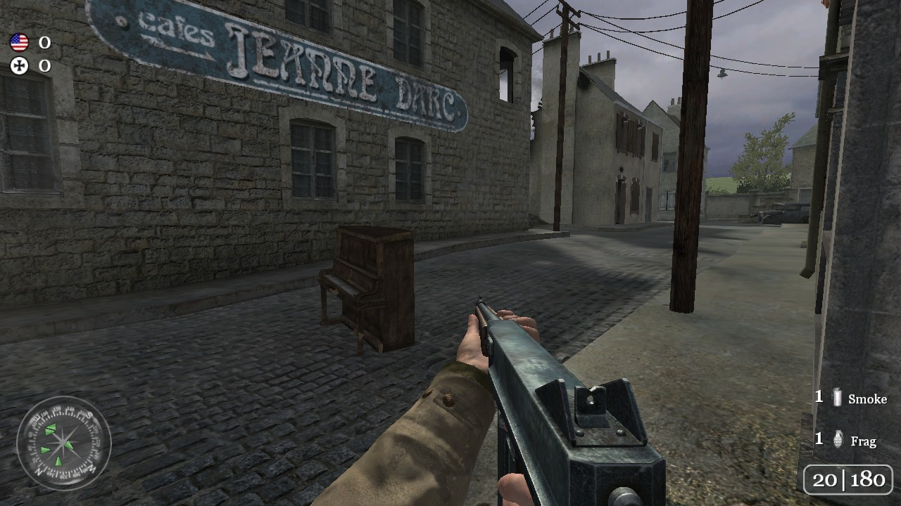
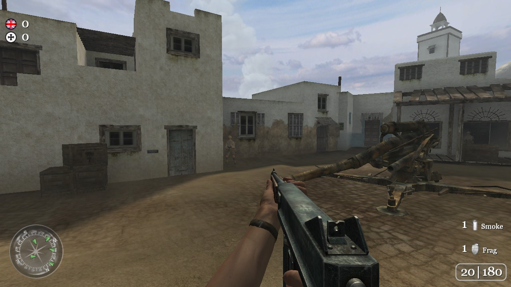
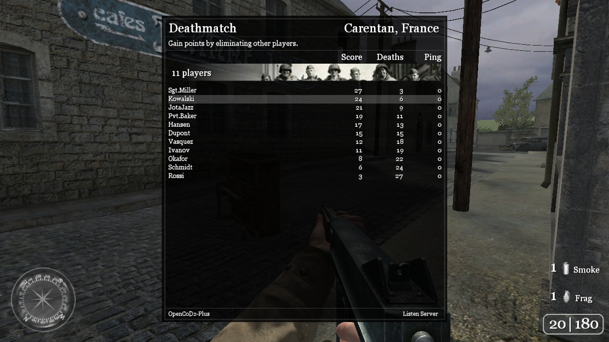

# OpenCoD2-Plus

<p align="center"></p>


[](https://github.com/opencod2/opencod2)
[](https://github.com/JotaJazz/opencod2-plus/commits/main)

[Español](README.es.md) · [English](README.md) · [Português](README.pt.md) · [Français](README.fr.md) · [Deutsch](README.de.md) · **Русский**

**Call of Duty 2 всё ещё жива.** OpenCoD2-Plus — это многопользовательский движок Call of Duty 2, воссозданный из исходного кода: клиент и выделенный сервер для Windows и Linux, созданные людьми, которые до сих пор играют в эту игру и продолжают её улучшать.

<table>
  <tr>
    <td></td>
    <td></td>
  </tr>
  <tr>
    <td colspan="2"></td>
  </tr>
</table>
<p align="center"><sub>Карантан, Тужан и локальная игра с ботами, нарисованные Linux-клиентом с собственными шейдерами игры.</sub></p>

## Что работает сегодня

- **Игра онлайн на публичных серверах 1.3** с клиентом для Windows, с оригинальным освещением: Direct3D 9 и собственные шейдеры игры. Моды сервера скачиваются по HTTP, если он их предлагает (`sv_wwwBaseURL`), в том числе в Windows.
- **Создание игры из клиента**, к которой подключаются друзья, по желанию с ботами (libcod).
- **Выделенный сервер для 1.3 и 1.0** на основе [CoD2rev-Plus](https://github.com/JotaJazz/CoD2rev-Plus): в Linux он проходит весь smoke-тест CoD2rev-Plus.
- **Клиент для Linux**, а также клиент на Vulkan (DXVK), который тоже рисует собственными шейдерами игры.
- **Проверено по оригинальным бинарным файлам 1.3**: предсказание движения, эффекты, звуки, отдача, меню и множество исправлений ([что изменилось](docs/changes.md)).

> [!NOTE]
> **Всё ещё в разработке.** Ожидайте ошибок и недостающих частей и, пожалуйста, сообщайте о них в [issues](https://github.com/JotaJazz/opencod2-plus/issues).

> [!IMPORTANT]
> **Игровой контент не включён — нужны собственные данные.** Этот репозиторий содержит только исходный код: никаких исполняемых файлов, архивов, карт, моделей, текстур, звуков или скриптов. Чтобы что-либо запустить, нужно предоставить файлы данных из копии игры, которой **вы законно владеете**.

## Как играть

Готовые к запуску сборки будут публиковаться на странице **Releases**. А пока соберите клиент (см. [Сборка](#сборка)) и укажите ему папку Call of Duty 2, ту, в которой есть `main/`:

```bat
cod2_win32.exe +set fs_basepath "C:\path\to\CoD2" +connect IP:port
```

```sh
./cod2_linux +set fs_basepath /path/to/CoD2 +connect IP:port
./cod2_linux_vk +set fs_basepath /path/to/CoD2 +connect IP:port   # with the game's own shaders (Vulkan)
```

Без `+connect` клиент открывает главное меню, где можно также создать собственную игру. Выделенный сервер для локальной сети:

```sh
./cod2_lnxded +set fs_basepath /path/to/CoD2 +set dedicated 1 +map mp_toujane
```

## Для участников

Важна любая помощь: играть и сообщать об ошибках, тестировать на других системах или писать код. Техническая документация, на английском, начинается с [docs/README.md](docs/README.md); [AGENTS.md](AGENTS.md) — точка входа для ИИ-агентов программирования.

## Сборка

Все цели собираются с помощью **CMake (≥ 3.16)**, каждая вне дерева исходников, в собственную папку.

### Linux

Движок — это 32-битный бинарный файл x86. В 64-битной системе Debian или Ubuntu нужны 32-битная архитектура и библиотеки:

```sh
sudo dpkg --add-architecture i386 && sudo apt update
sudo apt install build-essential gcc-multilib g++-multilib cmake \
     libsdl2-dev:i386 libgl1-mesa-dev:i386 libx11-dev:i386 \
     libcurl4-openssl-dev:i386 zlib1g-dev:i386 libstdc++6:i386
```

```sh
cmake -S . -B build-native
cmake --build build-native -j
# -> build-native/cod2_linux    (client)
# -> build-native/cod2_lnxded   (dedicated server)
```

Библиотеки клиента нужны для сборки обоих, но `cod2_lnxded` запускается только с 32-битными libc, libm, libz и libstdc++.

`cod2_linux` рисует временными шейдерами (без солнца, белое небо). Для собственных шейдеров игры соберите `cod2_linux_vk`: `scripts/build_linux_vk_deps.sh` собирает DXVK native и vkd3d-shader (32 бита, из зафиксированных версий; нужны также `meson`, `ninja` и `libvulkan1:i386`), затем настройте сборку с `-DCOD2_LINUX_DXVK=ON` в отдельном каталоге. Нужно устройство Vulkan.

### Windows (кросс-компиляция из Linux с помощью MinGW)

Нужны 32-битные компиляторы MinGW-w64 (`g++-mingw-w64-i686`) и статическая zlib для MinGW (`libz-mingw-w64-dev`).

```sh
cmake -S . -B build-win32 -DCMAKE_TOOLCHAIN_FILE=cmake/toolchain-mingw32.cmake
cmake --build build-win32 -j
# -> build-win32/cod2_win32_ded.exe   (dedicated server)
```

Добавьте `-DCOD2_WIN32_CLIENT=ON` для клиента, который рисует через Direct3D 9 и шейдеры игры (`-DCOD2_WIN32_REAL_D3D9=OFF`: GL-устройство) (статические библиотеки SDL2 нужно положить в `src/win32/sdl2/lib/`; выделенному серверу они не нужны). Как и Linux-клиент, он запускает локальные игры на сервере, game и bgame CoD2rev-Plus и использует его столкновения. Без Windows `scripts/portable_wine.sh DIR` устанавливает 32-битный Wine без root (Debian или Ubuntu с включённой архитектурой i386) и создаёт `DIR/wine.sh` для запуска; `COD2_CONSOLE_STDOUT=1` копирует консоль в stdout, а `scripts/listen_test.py --host-binary cod2_win32.exe --host-wine DIR/wine.sh` заставляет его создать игру, к которой подключается Linux-клиент.

<details>
<summary><b>Windows (MSVC, нативно)</b></summary>

Нативная сборка полного клиента SDL2/GL с Visual Studio 2022 или новее и её набором инструментов **x86**. Настройте и соберите из командной строки "x86 Native Tools for VS":

```bat
cmake --preset msvc-client
cmake --build build/msvc --target cod2_win32
:: -> build/msvc/cod2_win32.exe

cmake --preset msvc-client-release
cmake --build build/msvc-release --target cod2_win32
:: -> build/msvc-release/cod2_win32.exe   (/O2)
```

Эта сборка по-прежнему компилирует C и использует реконструированную виртуальную машину скриптов (`src/PC/script`). SDL2 предоставляете вы: положите 32-битный пакет разработки SDL2 для MSVC в `third_party/SDL2-<version>/` и скопируйте `SDL2.dll` рядом с исполняемым файлом. С `-DCOD2_SDL2_STATIC=ON` она компонует статическую SDL2, собранную вами (`SDL2-static.lib`, в той же конфигурации, что и движок), и статическую среду выполнения C в один исполняемый файл, которому не нужны DLL; собирайте SDL2 с `-DSDL_STATIC=ON -DSDL_SHARED=OFF -DSDL_RENDER=OFF -DSDL_FORCE_STATIC_VCRT=ON`. Release применяет `/O2` к коду, верному декомпилятору, который проверен хуже, чем сборка Debug: если что-то ведёт себя неправильно только в Release, подозревайте оптимизатор.

</details>

<details>
<summary><b>Параметры CMake</b></summary>

| Параметр | По умолчанию | Описание |
| --- | --- | --- |
| `COD2_CXX_ALL` | `ON` | Компилирует движок как C++ в Linux и MinGW. `OFF` собирает C. |
| `COD2_CXX_DIRS` | `""` | С `COD2_CXX_ALL=OFF` — модули или файлы `src/`, которые всё равно компилируются как C++. |
| `COD2_PLUS_SCRIPT` | `ON` | Виртуальная машина скриптов CoD2rev-Plus (`src/script`) в Linux и MinGW. `OFF` использует реконструированную (`src/PC/script`), как это делают MSVC, веб-сборка и x64. |
| `COD2_PLUS_SERVER` | `ON` | Сервер, game, bgame и ядро CoD2rev-Plus (`src/server`, `src/game`, `src/bgame`, `src/universal`, `src/qcommon`, `src/xanim`, `src/unix` или `src/win32`) в выделенном сервере, в Linux и MinGW; требует `COD2_PLUS_SCRIPT`. `OFF` использует реконструированные (`src/PC/server_mp`, `src/PC/game_mp`, `src/PC/bgame`). |
| `COD2_PLUS_CLIENT_SERVER` | `ON` | Сервер, game, bgame и столкновения CoD2rev-Plus для локальных игр клиента (Linux, и MinGW с `COD2_WIN32_CLIENT`), на ядре движка; требует `COD2_PLUS_SERVER`. `OFF` оставляет `src/PC/server_mp`, как пока делают MSVC, веб-сборка и x64. |
| `COD2_PLUS_LIBCOD` | `ON` | libcod из CoD2rev-Plus (`src/libcod`) в выделенном сервере и, с `COD2_PLUS_CLIENT_SERVER`, в локальных играх клиента, с её модулями, кроме MySQL; требует `COD2_PLUS_SERVER`. |
| `COD2_FEATURE_CFLAGS` | `""` | Переключатели возможностей; `-DCOD2_PATCH_10` собирает версию 1.0. |
| `COD2_WIN32_CLIENT` | `OFF` | MinGW: клиент вместо выделенного сервера. |
| `COD2_WIN32_REAL_D3D9` | `ON` | Клиент MinGW: настоящий Direct3D 9 и шейдеры игры (d3dx9 системы); `OFF` оставляет GL-устройство. |
| `COD2_WIN_MSVC` | `OFF` | Нативная сборка MSVC (задаётся пресетами `msvc-client`). |
| `COD2_SDL2_STATIC` | `OFF` | MSVC: один автономный исполняемый файл со статическими SDL2 и средой выполнения C. |
| `COD2_DEBUG` | `OFF` | `-O0` и без усиления защиты, для отладки. |
| `COD2_X64` | `OFF` | Цель x86_64; порт в процессе, который компилируется, но пока не запускается. |

Есть также сборка WebAssembly (`emcmake cmake -S . -B build/web`, с Emscripten SDK), описанная в начале `CMakeLists.txt`.

</details>

## Тесты

<details>
<summary><b>Тестовые скрипты</b></summary>

Проверкам нужна сборка, а тем, которые запускают сервер, — папка игры с оригинальными файлами `.iwd`. Они запускают сервер в режиме LAN с временной домашней папкой, поэтому папка игры только читается.

```bash
python3 scripts/build_check.py all                      # every variant (linux, linux-10, mingw, mingw-client...) into build/check-*/
python3 scripts/check_c_linkage.py build/check-linux    # no unexpected C++ names in the engine
python3 scripts/layout_parity.py                        # types shared with CoD2rev-Plus's VM lay out alike
python3 scripts/check_c_decls.py build/check-linux     # каждый вызов движка совпадает с типами своего определения
python3 scripts/check_var_sizes.py build/check-linux    # ни одна глобальная переменная не используется больше, чем определена
python3 scripts/opencod2_smoke.py /path/to/CoD2 --protocol 118
python3 scripts/two_players_test.py /path/to/CoD2 --protocol 118
python3 scripts/listen_test.py /path/to/CoD2 --protocol 118
python3 scripts/map_reload_test.py /path/to/CoD2 --protocol 118
python3 scripts/rcon_drop_test.py /path/to/CoD2 --protocol 118
python3 scripts/anim_builtins_test.py /path/to/CoD2 --protocol 118
python3 scripts/prediction_test.py /path/to/CoD2 --protocol 118
python3 scripts/fx_test.py /path/to/CoD2 --protocol 118
python3 scripts/hud_align_test.py /path/to/CoD2 --protocol 118
python3 scripts/www_download_test.py /path/to/CoD2
python3 scripts/bots_test.py /path/to/CoD2 --binary build/check-linux/cod2_lnxded
python3 scripts/http_test.py /path/to/CoD2 --binary build/check-linux/cod2_lnxded
python3 scripts/vendor_check.py /path/to/CoD2rev-Plus   # files copied from CoD2rev-Plus are unchanged
python3 -m unittest discover -s test
```

- `opencod2_smoke.py` запускает `scripts/smoke_test.py` из CoD2rev-Plus, без изменений, и сравнивает его ошибки с `test/smoke_expected_failures_<protocol>.txt`: проверками, которые этот сервер пока не проходит. Он завершается с ошибкой при новой ошибке и при проверке из списка, которая теперь проходит, поэтому списки только сокращаются. `--protocol 115` тестирует сборку 1.0. `--protocol 118 --binary build/check-mingw/cod2_win32_ded.exe --wine DIR/wine.sh` запускает его против выделенного сервера Windows под Wine (`scripts/portable_wine.sh`) со своим списком, `test/smoke_expected_failures_wine.txt`: под Wine сервер пишет только в своё окно, а сигнал не доходит до него как сигнал (SIGSEGV, отправленный через `kill`, игнорируется, SIGTERM сразу завершает его), поэтому отчёт о сбое, проверки SIGTERM и проверки его вывода там не выполняются (скрипт проверяет `net_strictPort` в его журнале консоли). Списки для Linux пусты: выделенный сервер проходит весь smoke-тест.
- `two_players_test.py` подключает двух клиентов на tdm, заставляет их отправлять команды, отключает одного и возвращает его, а другого кикает; сервер, с `developer 1`, чтобы ошибка скрипта останавливала карту, должен отвечать после каждого шага.
- `listen_test.py` запускает клиент, который создаёт игру, и второй, который к ней подключается, и проверяет их после `map_restart` и смены карты; нужен CD-ключ в `~/.cod2/preferences`.
- `map_reload_test.py` загружает карты через rcon, чередуя `map_restart` и `map` между двумя картами, и проверяет каждую загрузку; `rcon_drop_test.py` вызывает ошибку drop из rcon (`error drop`) и проверяет, что сервер продолжает работать.
- `anim_builtins_test.py` запускает `getAnimLength`, `animHasNotetrack`, `getMoveDelta` и `getAngleDelta` из скрипта уровня тестового мода.
- `prediction_test.py` считает ошибки предсказания настоящего клиента (с CD-ключом), который ходит, приседает, ложится, прыгает и стреляет; `--max-misses` задаёт допустимое число.
- `fx_test.py` заставляет настоящего клиента (с CD-ключом) проиграть перед собой спрайт, попадание пули и два взрыва и проверяет, что каждый меняет снимок экрана.
- `hud_align_test.py` даёт настоящему клиенту (с CD-ключом) три цветных квадрата с разными парами `horzAlign`/`vertAlign`, как у заголовка killcam, и проверяет на снимке экрана, что каждый стоит там, где его ставит 1.3.
- `www_download_test.py` подключает клиента к серверу, мода которого у него нет, и скачивает мод с локального HTTP-сервера; `--wine DIR/wine.sh --binary build/check-mingw-client/cod2_win32.exe` запускает клиент для Windows, `--disconnect` позволяет серверу попросить его выйти, скачать и вернуться.
- `bots_test.py` и `http_test.py` взяты из CoD2rev-Plus без изменений и проверяют libcod: боты из `mods/bots` должны находить пути, сохранять и перечитывать свой граф и сражаться на настоящей карте; `httpFetch` и `webSocket*` должны работать с локальными серверами HTTP, HTTPS, WS и WSS (нужен `openssl`). Передайте им `--binary build/check-linux/cod2_lnxded`.
- `scripts/cxx_errors.py` подсчитывает ошибки C++ модуля (`--return-type` находит функции, возвращающие значение, которые могут завершиться без return, что в C++ является неопределённым поведением); `scripts/gen_script_bridge.py --module script|server|client_server` заново генерирует мост к виртуальной машине скриптов или к серверу, а `scripts/engine_abi.py --module server` записывает с помощью gdb ABI движка, по которому проверяется мост (`test/server_abi.txt`).

</details>

## Структура репозитория

<details>
<summary><b>Что где находится</b></summary>

| Путь | Содержимое |
| --- | --- |
| `src/PC` | Реконструированный движок: клиент (`client_mp`, `cgame_mp`, `ui_mp`), сервер (`server_mp`), игра (`game_mp`, `bgame`), рендерер (`gfx_d3d`), общий код (`qcommon`, `universal`), анимации (`xanim`) и реконструированная виртуальная машина скриптов (`script`). В Linux и в выделенном сервере MinGW `server_mp`, `game_mp`, `game` и ядро, которое заменяет CoD2rev-Plus, не используются (`test/plus_replaces.txt`); клиент MinGW не использует `server_mp`, `game_mp`, `game` и столкновения движка. |
| `src/Mac` | Платформенный слой порта для Mac, из которого получена реконструкция: OpenGL за интерфейсом Direct3D, ввод и звук. |
| `src/script` | Виртуальная машина скриптов CoD2rev-Plus, скопированная без изменений, с нужными ей заголовками в `src/qcommon`, `src/universal`, `src/game`, `src/bgame`, `src/server`, `src/xanim`, `src/zlib`, `src/misc` и `src/libcod`. |
| `src/server` | Сервер CoD2rev-Plus, скопированный без изменений; его использует выделенный сервер. |
| `src/game`, `src/bgame` | Game и bgame CoD2rev-Plus, скопированные без изменений; их использует выделенный сервер. |
| `src/universal`, `src/qcommon`, `src/xanim`, `src/unix`, `src/win32` | Ядро и код платформы CoD2rev-Plus, скопированные без изменений; на них работает выделенный сервер. `test/plus_replaces.txt` перечисляет исходники движка, которые они там заменяют. |
| `src/libcod`, `mods/bots` | libcod из CoD2rev-Plus и её библиотеки (yyjson, SQLite, Mbed TLS; её Speex не собирается, используется Speex движка) и её мод ботов, скопированные без изменений; их используют выделенный сервер и локальные игры клиента. |
| `src/compat` | Мосты между C-именами движка и виртуальной машиной C++, сервером и ядром из CoD2rev-Plus; в основном сгенерированы. |
| `src/headers`, `src/imports` | Общие типы, смещения, проверенные по оригинальному бинарному файлу, и объявления импортируемых функций. |
| `src/blobs`, `build/native_gen`, `build/win_gen` | Данные, взятые из оригинального бинарного файла, которые движок всё ещё использует. |
| `src/unix`, `src/win32`, `src/stubs`, `src/web` | Код, зависящий от платформы, и заглушки. |
| `scripts` | Скрипты сборки и тестов, а также тестовый клиент из CoD2rev-Plus. |
| `test` | Юнит-тесты и списки, которые читают проверки. |
| `docs` | [Документация](docs/README.md) и баннер. |

</details>

## Прозрачность

- **Кто это поддерживает:** я JotaJazz. Мне нравятся старые игры, и именно поэтому существует этот форк: я хочу и дальше играть в CoD2 с друзьями и поддерживать игру живой для сообщества, которое всё ещё в неё играет, с помощью открытого проекта.
- **Как здесь ведётся работа:** я работаю с [Claude Code](https://claude.com/claude-code), помощником по программированию от Anthropic. Изменения этого форка, включая этот README и его переводы, написаны с его помощью. Сделанные так коммиты содержат в сообщении строку `Co-Authored-By: Claude`, поэтому их можно найти в истории через `git log`.
- **Отношения с оригиналом:** реконструкция — работа авторов opencod2 (riicchhaarrd) и Sipex. Этот форк больше не забирает у них изменения; вместо этого он переносит код из CoD2rev-Plus, скопированный без изменений, чтобы его коммиты применялись и здесь.
- **Лицензия:** пока нет, как и у оригинала. Код CoD2rev-Plus здесь (виртуальная машина скриптов, сервер, game, ядро, libcod и её мод ботов) распространяется под AGPL-3.0, а лицензия всего проекта согласовывается с авторами оригинала. Сторонние библиотеки сохраняют свои: SQLite (общественное достояние), Mbed TLS (Apache-2.0, `src/libcod/mbedtls/LICENSE`), yyjson (MIT) и Speex (BSD, не собирается).
- **Чем это не является:** это не официальный проект, и он не связан с Activision, Infinity Ward или авторами оригинального репозитория. В нём нет файлов игры.

## Уведомление

Это независимая реконструкция движка Call of Duty 2 на уровне исходного кода. Она не связана с Activision Publishing, Inc., Infinity Ward или какими-либо их аффилированными лицами, не авторизована, не спонсируется и не одобрена ими.

«Call of Duty» и «Call of Duty 2» являются товарными знаками Activision Publishing, Inc. В этом репозитории они используются только для идентификации и обеспечения совместимости, чтобы описать, что реконструирует код. Никаких прав на эти знаки не заявляется.

Этот проект не предоставляет защищённые авторским правом игровые данные и не помогает их получить. Чтобы использовать его с настоящим игровым контентом, вы должны предоставить файлы данных из копии Call of Duty 2, которой вы законно владеете.

Исходный код реконструированного движка является производным произведением, созданным в целях сохранения, обеспечения совместимости, исследований и образования. Он предоставляется «как есть», без каких-либо гарантий, явных или подразумеваемых.

Если вы являетесь правообладателем и считаете, что что-то здесь не должно распространяться, пожалуйста, откройте issue или свяжитесь с сопровождающим, и вопрос будет оперативно рассмотрен.

На снимках экрана показан контент Call of Duty 2, принадлежащий Activision Publishing, Inc., только для идентификации.

## Благодарности

- [opencod2](https://github.com/opencod2/opencod2) (riicchhaarrd), реконструкция движка
- [Sipex18/opencod2-web](https://github.com/Sipex18/opencod2-web) (Sipex), усиление защиты и сетевые исправления
- [CoD2rev-Plus](https://github.com/JotaJazz/CoD2rev-Plus) и [voron00/CoD2rev_Server](https://github.com/voron00/CoD2rev_Server), выделенный сервер и виртуальная машина скриптов
- id Software
- Activision / Infinity Ward
